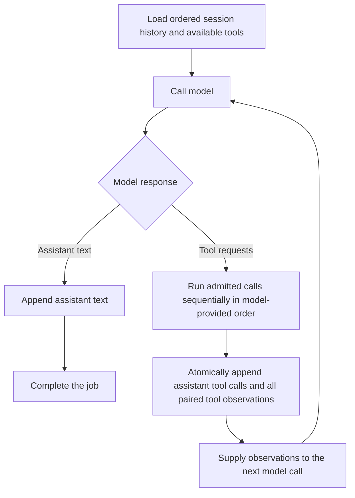

# Conversations and message processing

[Home](../README.md) | [繁體中文](conversations.zh-TW.md) | [Question index](README.md) | [HTTP API reference](http-api.md)

This guide summarizes how a user message moves through conversation processing. The complete [HTTP API reference](http-api.md) owns request and response contracts, history shapes, job state, cancellation, pagination, and cache reports.

## Conversation loop

One submitted user message starts one ordered job. A job can make one or more model calls:

Within the ordinary call allowance, the runtime runs admitted tool calls sequentially in the order returned by the model. It commits the assistant calls and their paired observations as one history batch, then supplies those observations to the next model call. The runtime exposes registered tools but does not interpret a provider's input schema or tool output. One ordinary tool failure is recorded as that tool's observation and does not prevent later calls in the same batch.

## Call allowance, handoff, and retries

`session-agent.model.max-model-calls-per-message` bounds ordinary execution and context-compaction requests for one user message. Its environment form is `SESSION_AGENT_MAX_MODEL_CALLS_PER_MESSAGE`; the default is 12. Failed ordinary attempts and retries consume this allowance, and each actual provider request is reserved before sending.

A direct text answer on the last allowed ordinary request completes normally. Tool calls returned on that request are not executed or appended. Instead, bounded `WRAP_UP` handling may make at most one no-tools model request to summarize confirmed progress and gaps and ask whether to continue investigating or organize the evidence. The resulting waiting state is not a running job; recovery does not repeat a reserved but lost wrap-up request. Cancellation takes precedence and cannot publish a waiting prompt or release artifacts.

Provider continuation is internal replay state for the current job, not a future session turn or HTTP history field. It is committed with its assistant/tool batch and survives retry and valid reclaim. Completion or cancellation removes the remaining continuation without deleting committed history.

Spring AI retries are disabled with `spring.ai.retry.max-attempts=1`. The conversation-job loop owns retries for transient provider failures, preserving the already-counted call and avoiding duplicate history. Runtime reserves each provider request before dispatch, but a crash or ownership loss can leave a reservation undispatched. Reserved counts are not proof of requests sent or billed; a gateway's internal attempts are outside Runtime's reservation bound.

## Queue and recovery

The defaults are `session-agent.worker.concurrency: 4` and `session-agent.worker.max-unfinished-jobs: 100`. Capacity counts `PENDING`, `WORKING`, and `RETRY` jobs together; terminal jobs release capacity. The database is the waiting queue: jobs in one session run FIFO, while different sessions can run in parallel. HTTP and Slack share admission; duplicate resolution happens before checking capacity for new jobs. See the [HTTP API reference](http-api.md) for intake outcomes and validation.

If a known storage failure stops a tool batch before its history append begins, recovery preserves observations already obtained and records unstarted calls as `TOOL_NOT_EXECUTED`. The complete assistant/tool batch and its `RETRY` transition commit together. If that retry transition fails, the batch is not left separately committed. Once append or recovery has begun, a failed response can mean the transaction committed: Runtime does not invent results or blindly resend a possibly committed batch.

Tool execution has no runtime deduplication layer. A read-only tool can run again if the process crashes after execution but before its observation batch commits. Any side-effecting tool must provide idempotency at its adapter or external-service boundary; this is not exactly-once execution.

## Cancellation

Cancellation is cooperative, not a rollback or forced interruption. A queued `PENDING` or `RETRY` job can become cancelled without another model call. A running job stops at a safe point after an already-admitted model/tool operation finishes or times out; a cancellation request alone does not acknowledge that the job has stopped. Cancellation does not forcibly abort remote OMP/MCP work, refund reserved model calls, or undo tool side effects. Recovery does not replay work for a job with a persisted cancellation request. See the [HTTP API cancellation contract](http-api.md#jobs-cancellation-and-history) for response and history details.

## History and public contracts

Committed conversation history is the audit record; provider continuation and other operational state are not HTTP history fields. Tool inputs and outputs remain opaque runtime data, and MCP observations preserve both human-readable content and structured content when supplied. For the complete event shapes, job and phase fields, cache report semantics, session model selection, and delivery status, use the [HTTP API reference](http-api.md).
