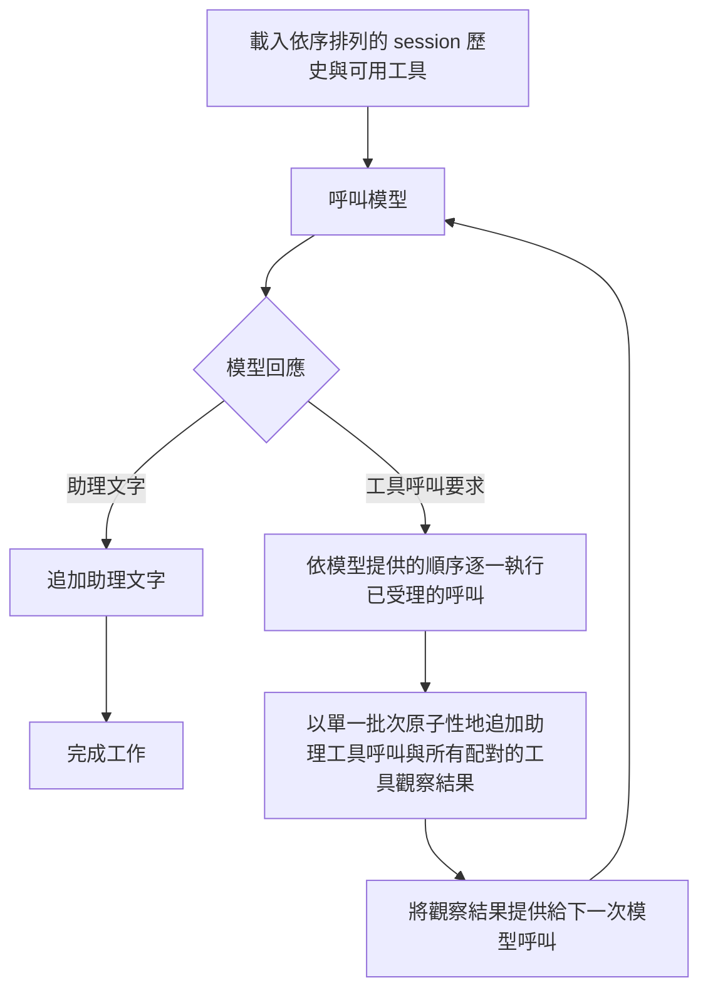

# 對話與訊息處理

[首頁](../README.zh-TW.md) | [English](conversations.md) | [問題索引](README.zh-TW.md) | [HTTP API 參考](http-api.zh-TW.md)

本指南摘要使用者訊息如何進入對話處理。完整的 [HTTP API 參考](http-api.zh-TW.md) 是請求與回應契約、歷史格式、工作狀態、取消、分頁及快取報告的唯一詳細來源。

## 對話循環

一則已提交的使用者訊息會啟動一個依序執行的工作。一個工作可以進行一次或多次模型呼叫：

在一般呼叫額度內，Runtime 會依模型回傳的順序逐一執行已受理的工具呼叫。助理呼叫及其配對觀察結果會以單一歷史批次提交，接著將觀察結果提供給下一次模型呼叫。Runtime 會向模型公開已註冊的工具，但不會解讀供應商的輸入結構描述或工具輸出。單一一般工具失敗會記錄為該工具的觀察結果，不會阻止同一批次中的後續呼叫。

## 呼叫額度、交接與重試

`session-agent.model.max-model-calls-per-message` 限制單一使用者訊息的一般執行與上下文壓縮請求。對應的環境變數名稱為 `SESSION_AGENT_MAX_MODEL_CALLS_PER_MESSAGE`；預設值是 12。一般嘗試與重試失敗都會消耗此額度，而且每個實際供應商請求都會在送出前預留。

最後一次允許的一般請求若直接回覆文字，會正常完成。該次請求若回傳工具呼叫，則不會執行或追加這些呼叫。接著，有界的 `WRAP_UP` 處理最多可進行一次不含工具的模型請求，簡述已確認的進度與缺口，並詢問要繼續調查還是整理證據。產生的等待狀態不是執行中的工作；若收尾請求已預留但結果遺失，恢復流程不會重複呼叫。取消優先於交接，不會發布等待提示或釋出 artifacts。

供應商 continuation 是目前工作專用的內部重播狀態，不屬於未來的 session 回合，也不是 HTTP 歷史欄位。它會與助理／工具批次一同提交，並在重試與有效的重新認領後保留。工作完成或取消時會移除剩餘 continuation，但不會刪除已提交的歷史。

`spring.ai.retry.max-attempts=1` 會停用 Spring AI 重試。瞬時供應商失敗的重試由對話工作迴圈負責；該迴圈會保留已計數的呼叫，並避免重複歷史。Runtime 在送出前預留每個供應商請求，但 crash 或所有權遺失可能留下未送出的預留。因此，預留計數不證明已送出或已計費的請求；閘道內部的 attempts 不受 Runtime 預留上限約束。

## 佇列與恢復

預設值為 `session-agent.worker.concurrency: 4` 與
`session-agent.worker.max-unfinished-jobs: 100`。容量合併計算 `PENDING`、`WORKING` 與
`RETRY` 工作；終止狀態的工作會釋出容量。資料庫就是等待佇列：同一個 session 的工作依 FIFO 執行，不同 session 的工作則可並行執行。HTTP 與 Slack 共用准入機制；檢查新工作容量之前會先解析重複訊息。收訊結果與驗證規則請參閱 [HTTP API 參考](http-api.zh-TW.md)。

若已知的儲存失敗在工具批次開始追加歷史前使其停止，恢復流程會保留已取得的觀察結果，並將尚未開始的呼叫記錄為 `TOOL_NOT_EXECUTED`。完整的助理／工具批次及其 `RETRY` 轉換會一同提交。重試轉換失敗時，不會將批次另外提交。追加或恢復程序開始後，失敗的回應可能代表交易已提交：Runtime 不會捏造結果，也不會盲目重送可能已提交的批次。

工具執行沒有 Runtime 去重層。如果程序在工具執行後、觀察結果批次提交前當機，唯讀工具可能再次執行。任何具副作用的工具都必須在 adapter 或外部服務邊界提供冪等性；這不保證只執行一次。

## 取消

取消採合作式處理，不是回滾或強制中斷。排隊中的 `PENDING` 或 `RETRY` 工作可在不再呼叫模型的情況下轉為已取消。執行中的工作會等已受理的模型／工具操作完成或逾時，再於安全點停止；單獨提出取消請求不代表已確認工作停止。取消不會強制中止遠端 OMP/MCP 工作、不會退還已預留的模型呼叫，也不會回復工具副作用。若工作已有持久化的取消請求，恢復流程不會重播該工作。回應與歷史細節請參閱 [HTTP API 取消契約](http-api.zh-TW.md#工作取消與歷史)。

## 歷史與公開契約

已提交的對話歷史是稽核紀錄；供應商 continuation 與其他操作狀態不屬於 HTTP 歷史欄位。工具輸入與輸出維持 Runtime 不透明資料；若 MCP 提供可供人閱讀的內容與結構化內容，兩者都會保留。完整事件格式、工作與階段欄位、快取報告語意、session 模型選擇及投遞狀態，請參閱 [HTTP API 參考](http-api.zh-TW.md)。
